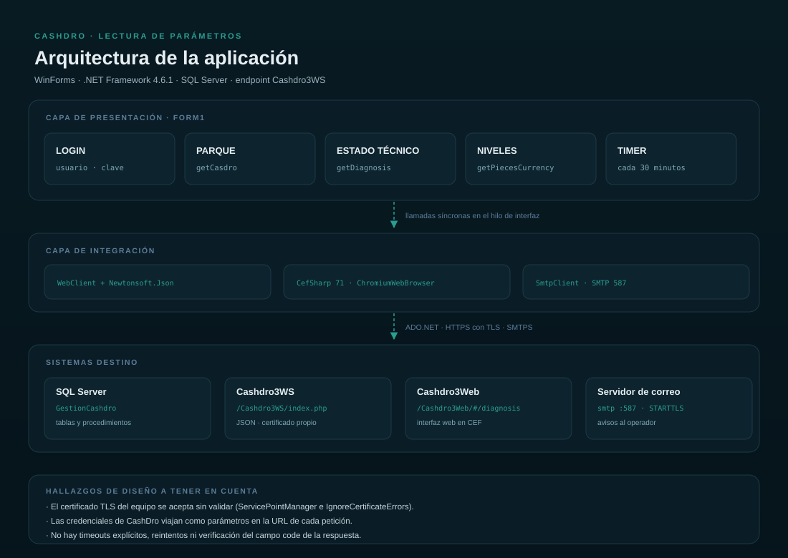
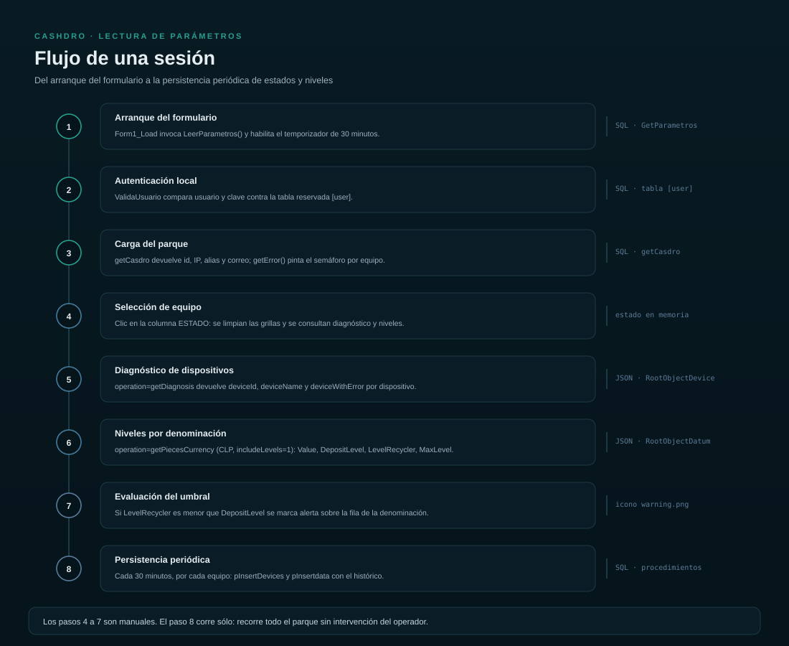
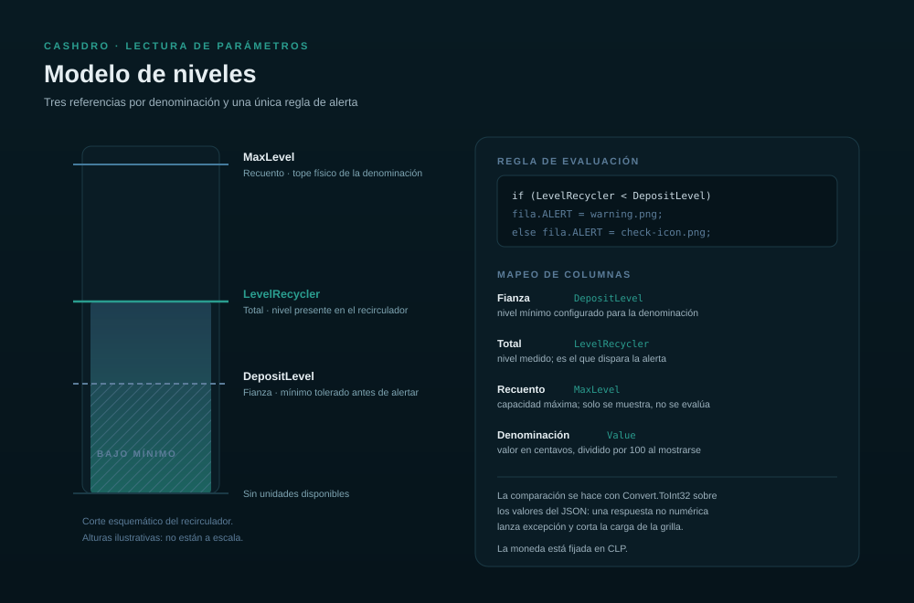

# Lectura de parámetros CashDro

**Aplicación de escritorio para consultar los parámetros técnicos y financieros de un
parque de máquinas CashDro desde un único puesto Windows.**

`C#` · `WinForms` · `.NET Framework 4.6.1` · `SQL Server` · `CefSharp` · `Licencia MIT`

---

## Tabla de contenido

1. [Qué es](#1-qué-es)
2. [El problema que resuelve](#2-el-problema-que-resuelve)
3. [Principio de funcionamiento](#3-principio-de-funcionamiento)
4. [La pantalla](#4-la-pantalla)
5. [Arquitectura](#5-arquitectura)
6. [Flujo de una sesión](#6-flujo-de-una-sesión)
7. [Conexión con CashDro](#7-conexión-con-cashdro)
8. [Parámetros leídos](#8-parámetros-leídos)
9. [Modelo de niveles](#9-modelo-de-niveles)
10. [Persistencia en SQL Server](#10-persistencia-en-sql-server)
11. [Configuración](#11-configuración)
12. [Compilación](#12-compilación)
13. [Operación](#13-operación)
14. [Ejemplos de uso](#14-ejemplos-de-uso)
15. [Ajuste de umbrales](#15-ajuste-de-umbrales)
16. [Códigos de error y diagnóstico](#16-códigos-de-error-y-diagnóstico)
17. [Seguridad](#17-seguridad)
18. [Límites y estado de esta revisión](#18-límites-y-estado-de-esta-revisión)
19. [Estructura del repositorio](#19-estructura-del-repositorio)
20. [Documentación adicional](#20-documentación-adicional)
21. [Licencia](#21-licencia)

---

## 1. Qué es

Un formulario Windows que se conecta por HTTPS a la API interna de cada máquina CashDro,
lee dos conjuntos de datos y los muestra en tres grillas:

| Grilla | Contenido | Origen |
|---|---|---|
| **Parque de máquinas** | Una fila por equipo, con IP, alias y semáforo | SQL Server (`getCasdro`) |
| **Estado técnico** | Un renglón por dispositivo interno del equipo | `getDiagnosis` |
| **Consulta niveles On Line** | Un renglón por denominación, con fianza, total y recuento | `getPiecesCurrency` |

Además, cada 30 minutos recorre todo el parque y escribe el resultado en SQL Server, de
modo que se construye un histórico de estados y niveles sin intervención humana.

> **Alcance**: aplicación de **solo lectura**. No configura, no carga, no retira y no
> reinicia nada en la máquina. Consulta y registra.

### 1.1 Ficha rápida

| Campo | Valor |
|---|---|
| Nombre del proyecto | `cashdro` |
| Tipo | `WinExe` (aplicación de escritorio) |
| Framework | .NET Framework 4.6.1 |
| Solución | Visual Studio 2017, formato 12.00 |
| Plataforma | **Windows únicamente** |
| Persistencia | SQL Server, base `GestionCashdro` |
| Interfaz web embebida | CefSharp 71 (Chromium) |
| Moneda | `CLP`, fija en esta versión |
| Intervalo de monitoreo | 30 minutos |
| Licencia | MIT |

---

## 2. El problema que resuelve

Un operador que administra varias máquinas CashDro enfrenta tres preguntas todos los días:

1. **¿Alguna máquina tiene un dispositivo en falla?**
   La consola del fabricante responde bien, pero hay que entrar equipo por equipo.
2. **¿Algún recirculador quedó por debajo del mínimo?**
   Si nadie lo nota, la máquina deja de devolver vuelto y el usuario final se queda sin
   cambio.
3. **¿Qué pasó ayer a las 15:00 cuando se cayó el lector?**
   Sin histórico, la respuesta se pierde.

La aplicación ataca las tres con una sola pantalla y un barrido periódico que persiste el
estado. El resultado es un tablero de monitoreo mínimo, no un sistema de gestión completo:
la máquina sigue siendo la fuente de verdad y la configuración se hace en ella.

### 2.1 Escenario típico

```text
07:50  El operador abre la aplicación y valida su usuario local.
07:51  Ve 12 máquinas: 11 con ✓ y una con ⚠.
07:52  La máquina 7 no responde: el semáforo está en rojo por criterio conservador.
07:55  El operador revisa el switch de la sucursal y la máquina vuelve.
08:00  Selecciona la máquina 3 y confirma que la denominación de $100 está bajo fianza.
08:01  Abre la consola web embebida y pide el recargue al supervisor.
08:30  El barrido automático guarda el estado de todo el parque en SQL Server.
```

---

## 3. Principio de funcionamiento

No hay sensor ni bus de campo: el principio es **sondeo HTTP con contrato JSON sobre una
red local**.

```text
   Petición GET (HTTPS, certificado autofirmado)
   ─────────────────────────────────────────────►
   https://<IP_EQUIPO>/Cashdro3WS/index.php?operation=getDiagnosis

   Respuesta JSON
   ◄─────────────────────────────────────────────
   { "code": 0, "data": { "WithError": false, "Devices": [ ... ] } }
```

Cuatro ideas sostienen el diseño:

1. **La máquina expone su estado por HTTP.** El servicio `Cashdro3WS` publica operaciones
   tipo RPC (`operation=...`) que devuelven JSON. No hay SDK ni base de datos directa.
2. **El certificado es autofirmado.** Por eso la aplicación desactiva la validación TLS
   (`ServicePointManager.ServerCertificateValidationCallback` y
   `IgnoreCertificateErrors` en CEF). Es la decisión de diseño más discutible del
   proyecto y se analiza en §17.
3. **La autenticación viaja en la URL.** El usuario y la clave de CashDro se concatenan
   como parámetros de la query string en las operaciones que los requieren.
4. **El estado se persiste por sondeo.** Un `System.Windows.Forms.Timer` dispara cada 30
   minutos un recorrido secuencial por todas las máquinas y guarda el resultado mediante
   procedimientos almacenados.

### 3.1 Qué se lee exactamente

- **Estado técnico**: la lista de dispositivos con un booleano `deviceWithError`.
- **Estado financiero**: por cada denominación, el nivel actual, el mínimo tolerado y la
  capacidad máxima.

Nada más. No se leen transacciones, no se leen logs de auditoría y no se modifica la
configuración del equipo.

---

## 4. La pantalla

El formulario mide 1088 × 580 px, se centra en pantalla y se titula `Sistema integrado`.
La disposición es fija (no hay anclaje responsive): está pensada para 1366 × 768 o más.

```text
LOGIN                      Parque de maquinas
Usuario [________]         Item │ IP Equipo │ Nombre │ ESTADO
Clave   [********]          1   │ <IP>      │ Caja 1 │   ✓
        [validar]           2   │ <IP>      │ Caja 2 │   ⚠

Estado tecnico                        Consulta Niveles On Line
Item │ Nombre │ Err? │ STATUS         Moneda │ Denom │ Fianza │ Total
```

| Etiqueta visible | Panel |
|---|---|
| `LOGIN` | Usuario y clave locales + botón `validar` |
| `Parque de maquinas` | Grilla principal del parque |
| `Estado tecnico` | Grilla de dispositivos del equipo elegido |
| `Consulta Niveles On Line` | Grilla de denominaciones del equipo elegido |

Los iconos de estado se cargan desde archivos PNG en disco (`D:\imagenes\`), no desde
recursos embebidos. Es un detalle de despliegue importante: si esa carpeta no existe, la
grilla falla al pintar.

---

## 5. Arquitectura



### 5.1 Capas

| Capa | Implementación | Archivo |
|---|---|---|
| Presentación | Un formulario principal y un visor modal | `Form1.cs`, `webBrownser.cs` |
| Integración HTTP | `WebClient` + `JsonConvert` | `Form1.cs` |
| Integración web | `ChromiumWebBrowser` (CefSharp) | `webBrownser.cs` |
| Integración de correo | `SmtpClient` | `Form1.cs` |
| Acceso a datos | `SqlConnection` / `SqlCommand` | `Form1.cs`, `funciones.cs` |
| Contratos | DTOs planos | `dataClass.cs` |

No hay separación real entre capas: la lógica de negocio, el acceso a datos y la
manipulación de controles conviven en `Form1.cs`. La arquitectura es, en la práctica, un
formulario que hace todo.

### 5.2 Archivos

| Archivo | Rol |
|---|---|
| `Program.cs` | Punto de entrada `[STAThread]` |
| `Form1.cs` | Login, consultas, persistencia, alertas |
| `Form1.Designer.cs` | Layout y columnas de las tres grillas |
| `dataClass.cs` | `RootObjectDevice`, `Device`, `RootObjectDatum`, `Datum` |
| `webBrownser.cs` | Visor Chromium embebido |
| `funciones.cs` | Utilidad de datos sin uso actual |
| `App.config` | Runtime .NET 4.6.1 y `probing privatePath="x86"` |
| `packages.config` | CefSharp, cef.redist, Newtonsoft.Json |
| `cashdro.csproj` / `.sln` | Proyecto y solución de Visual Studio |

### 5.3 Decisiones estructurales

- **Todo síncrono.** No hay `async`; las llamadas bloquean el hilo de interfaz. Simple de
  leer, malo para la experiencia cuando hay muchas máquinas.
- **Un solo formulario.** El visor web se abre como diálogo modal, no como pestaña.
- **Configuración embebida.** Cadena de conexión, ruta de imágenes, moneda y credenciales
  están en el código.
- **Persistencia por SP.** La base define el contrato de escritura; la aplicación solo
  envía parámetros.

---

## 6. Flujo de una sesión



| # | Paso | Detalle |
|---:|---|---|
| 1 | Arranque | `Form1_Load` ejecuta `LeerParametros()` y arma el timer |
| 2 | Login | `ValidaUsuario` consulta la tabla `[user]` |
| 3 | Parque | `getCasdro` trae `id`, `ip`, `alias`; `getError()` pinta el semáforo |
| 4 | Selección | Clic en la columna ESTADO → dos consultas |
| 5 | Diagnóstico | `getDiagnosis` → dispositivos |
| 6 | Niveles | `getPiecesCurrency` → denominaciones |
| 7 | Evaluación | `LevelRecycler < DepositLevel` → alerta |
| 8 | Persistencia | Timer → `pInsertDevices` + `pInsertdata` por equipo |

Los pasos 4 a 7 son manuales. El paso 8 corre solo. La consecuencia práctica es que el
histórico se construye **aunque nadie mire la pantalla**, pero el detalle por dispositivo
solo se ve cuando alguien lo pide.

---

## 7. Conexión con CashDro

### 7.1 Anatomía de las URL

```text
https://<IP_EQUIPO>/Cashdro3WS/index.php?operation=getDiagnosis

https://<IP_EQUIPO>/Cashdro3WS/index.php
        ?operation=getPiecesCurrency
        &currencyId=CLP
        &includeImages=0
        &includeLevels=1
        &name=USUARIO_CASHDRO
        &password=CLAVE_CASHDRO
```

| Elemento | Valor | Nota |
|---|---|---|
| Esquema | `https` | El equipo sirve TLS con certificado propio |
| Host | IP del equipo | No hay descubrimiento: la IP viene de SQL |
| Ruta | `/Cashdro3WS/index.php` | Endpoint del servicio |
| Operación | `getDiagnosis` / `getPiecesCurrency` | Selector tipo RPC |
| Moneda | `CLP` | Fija en el código |
| Imágenes | `includeImages=0` | Evita transferir base64 innecesario |
| Niveles | `includeLevels=1` | Necesario para fianza, total y recuento |

La consola web vive en otra ruta: `https://<IP_EQUIPO>/Cashdro3Web/#/diagnosis`. Es una
aplicación de una sola página que el visor CEF carga con las credenciales también en la
URL.

### 7.2 Comportamiento TLS

En `Form1()`:

```csharp
CefSettings settings = new CefSettings();
settings.IgnoreCertificateErrors = true;
Cef.Initialize(settings);
```

Y en cada método HTTP:

```csharp
ServicePointManager.ServerCertificateValidationCallback = delegate { return true; };
```

Es decir: **se acepta cualquier certificado, de cualquier host, durante toda la vida del
proceso**. Funciona, pero anula la única defensa contra un intermediario en la LAN. La
alternativa correcta es instalar el certificado del equipo en el almacén de confianza de
Windows y dejar la validación activa (§17.3).

### 7.3 Qué pasa si el equipo no responde

`getError()` captura cualquier excepción y devuelve `true`. El semáforo queda en ⚠ y la
máquina se considera con falla. Es un criterio **conservador y correcto** para monitoreo,
pero impide distinguir entre:

- equipo apagado,
- equipo con un dispositivo en falla,
- error de credenciales,
- cambio de contrato en el JSON.

Para distinguirlos hace falta registro (§16.3).

---

## 8. Parámetros leídos

### 8.1 Diagnóstico — `getDiagnosis`

| Campo | Tipo JSON | Significado operativo |
|---|---|---|
| `Devices[].deviceId` | object | Identificador del dispositivo (columna Item) |
| `Devices[].deviceName` | string | Nombre lógico (columna Nombre) |
| `Devices[].deviceWithError` | bool | Falla reportada (columna Error?) |

La respuesta trae además `code`, `data.WithError`, `deviceType`, `deviceState`,
`deviceModel`, `portName`, `portProtocol`, `portState`, `ip`, `tooManyChanges`,
`deviceMessagesInfo` y `portMessagesInfo`. Se deserializan y se descartan: **hay
información de diagnóstico disponible que la interfaz no muestra** (modelo, estado del
puerto, mensajes). Es la extensión más rentable del proyecto.

### 8.2 Niveles — `getPiecesCurrency`

| Campo | Tipo JSON | Significado |
|---|---|---|
| `CurrencyId` | string | Moneda (`CLP`) |
| `Value` | string | Valor facial **en centavos** |
| `DepositLevel` | string | Fianza: mínimo tolerado |
| `LevelRecycler` | object | Nivel actual del recirculador |
| `MaxLevel` | string | Capacidad máxima |

Se ignoran `code`, `MinLevel`, `MaxLevelTemp`, `DepositLevelTemp`, `Type`,
`Destination`, `MaxPiecesExchange`, `MaxPiecesChange`, `MaxPiecesCancel`,
`IsChargeable`, `State`, `Image` y `LevelCasete`. El diccionario completo, campo por
campo, está en [`docs/datasheet.md`](docs/datasheet.md).

### 8.3 Conversión de valores

`Value` llega en centavos y se muestra dividido por 100:

```csharp
string numero = d.Value.ToString();
dataGridViewdata.Rows[n].Cells[1].Value = Convert.ToUInt32(numero) / 100;
```

| `Value` recibido | Mostrado | Denominación real |
|---:|---:|---|
| `1000` | 10 | $10 |
| `5000` | 50 | $50 |
| `10000` | 100 | $100 |
| `50000` | 500 | $500 |
| `100000` | 1000 | $1 000 |
| `200000` | 2000 | $2 000 |

Como `CLP` no usa decimales, la división entera alcanza. Si algún día se habilita una
moneda con centavos reales, hay que cambiar la presentación y la comparación.

---

## 9. Modelo de niveles



Cada denominación tiene tres referencias y una regla:

```csharp
int depositlevel  = Convert.ToInt32(d.DepositLevel);   // mínimo tolerado
int levelrecycler = Convert.ToInt32(d.LevelRecycler);  // nivel actual

if (levelrecycler < depositlevel)
    // alerta: warning.png
else
    // normal: check-icon.png
```

| Columna en pantalla | Campo | Qué mirar |
|---|---|---|
| **Fianza** | `DepositLevel` | Umbral configurado en la máquina |
| **Total** | `LevelRecycler` | Piezas disponibles ahora |
| **Recuento** | `MaxLevel` | Tope físico; **no** participa de la alerta |

La alerta es **por denominación**, no por equipo: un equipo puede estar en verde de forma
global y tener una denominación en alerta. `picOk` (el semáforo grande) resume el parque
completo, no la fila seleccionada.

### 9.1 Por qué la alerta usa `<` y no `<=`

Con `Total == Fianza` la denominación se considera operativa. Si tu política interna exige
mantener un colchón por sobre el mínimo, el umbral debe configurarse más alto en la
máquina, no en la aplicación: la app compara contra lo que el equipo declara.

---

## 10. Persistencia en SQL Server

### 10.1 Objetos que la aplicación espera

| Objeto | Tipo | Entradas | Devuelve / efecto |
|---|---|---|---|
| `GetParametros` | SP | — | `CorreoFrom`, `CorreoPass`, `Cliente` |
| `getCasdro` | SP | — | `id`, `ip`, `alias`, `correoAlerta` |
| `[user]` | tabla | `usuario`, `pass` | Conteo para el login |
| `pInsertDevices` | SP | `@cliente`, `@deviceName`, `@deviceWithError`, `@IP` | Inserta estado técnico |
| `pInsertdata` | SP | `@cliente`, `@currencyId`, `@Value`, `@depositLevel`, `@LevelRecycler`, `@IP`, `@MaxLevel` | Inserta niveles |

La base se llama `GestionCashdro`. **No se incluye** en el repositorio: hay que crearla o
restaurarla desde el respaldo corporativo.

### 10.2 Esquema mínimo para un laboratorio

La base necesita cinco objetos:

| Objeto | Columnas imprescindibles |
|---|---|
| `[user]` | `usuario`, `pass` |
| `Parametros` | `CorreoFrom`, `CorreoPass`, `Cliente` |
| `Maquinas` | `id`, `ip`, `alias`, `correoAlerta` |
| `Devices` | `cliente`, `deviceName`, `deviceWithError`, `ip`, fecha de lectura |
| `Niveles` | `cliente`, `currencyId`, `Value`, `depositLevel`, `levelRecycler`, `maxLevel`, `ip`, fecha de lectura |

El DDL completo, listo para ejecutar, está en
[`docs/developer.md`](docs/developer.md) (§6.2). `[user]` va entre corchetes porque
`USER` es palabra reservada en T-SQL.

### 10.3 Costo del barrido

Cada tick abre una conexión por fila insertada. Con 20 equipos, 6 dispositivos y 8
denominaciones:

```text
20 × (6 + 8) = 280 conexiones y 280 comandos por tick
280 × 48 ticks/día ≈ 13 440 inserciones diarias
```

Es suficiente para un tablero, pero conviene agrupar en una transacción y reutilizar la
conexión; el patrón está descrito en
[`docs/developer.md`](docs/developer.md).

### 10.4 Consultas útiles sobre el histórico

```sql
-- Último estado conocido por equipo
SELECT ip, deviceName, deviceWithError, MAX(leido) AS visto
FROM Devices
GROUP BY ip, deviceName, deviceWithError
ORDER BY visto DESC;

-- Denominaciones que estuvieron bajo fianza en las últimas 24 horas
SELECT ip, currencyId, Value, levelRecycler, depositLevel, leido
FROM Niveles
WHERE leido >= DATEADD(HOUR, -24, GETDATE())
  AND TRY_CONVERT(INT, levelRecycler) < TRY_CONVERT(INT, depositLevel)
ORDER BY leido DESC;

-- Equipos que dejaron de reportar
SELECT ip, MAX(leido) AS ultimo
FROM Devices
GROUP BY ip
HAVING MAX(leido) < DATEADD(HOUR, -2, GETDATE());
```

---

## 11. Configuración

No hay archivo de configuración funcional: todo está en el código. Estos son los puntos
que hay que tocar antes de compilar o desplegar.

| Qué | Dónde | Valor en el repositorio |
|---|---|---|
| Cadena de conexión SQL | `Form1.cs`, campo `_cnLocal`; `funciones.cs`, campo `cnLocal` | `Data Source=<SERVIDOR>;Initial Catalog=GestionCashdro;User Id=USUARIO_CASHDRO;Password=CLAVE_CASHDRO` |
| Ruta de iconos | `Form1.cs`, campo `pathImg` | `D:\imagenes\` |
| Moneda | `cargaGridData` / `cargaTblData` | `CLP` |
| Intervalo del timer | `Form1_Load` | `1 800 000` ms |
| Servidor SMTP | `enviaCorreo` | `smtp.gmail.com`, puerto 587, SSL |
| Destinatario de alertas | `getCasdro` → `correoAlerta` | Por equipo |
| Remitente y clave | `GetParametros` → `CorreoFrom`, `CorreoPass` | En base de datos |
| Credenciales CashDro | URL de `getPiecesCurrency` y del visor | `USUARIO_CASHDRO` / `CLAVE_CASHDRO` (marcadores) |

### 11.1 Cadena de conexión

```text
Data Source=<SERVIDOR>\<INSTANCIA>;Initial Catalog=GestionCashdro;
User Id=<USUARIO>;Password=<CLAVE>;Connect Timeout=5
```

Se usa autenticación SQL (usuario y clave en la cadena), no autenticación integrada de
Windows. La cadena está duplicada en dos archivos; si la cambias, cámbiala en ambos
(aunque `funciones.cs` no se use, deja una copia de las credenciales en el binario).

### 11.2 Archivos que deben existir en el puesto

| Archivo | Ruta | Contenido |
|---|---|---|
| `warning.png` | `D:\imagenes\warning.png` | Icono de alerta |
| `check-icon.png` | `D:\imagenes\check-icon.png` | Icono correcto |
| `libcef.dll` y recursos | junto al `.exe` | Los copia NuGet al compilar |
| `Newtonsoft.Json.dll` | junto al `.exe` | Ídem |

Los dos PNG **no** están en el repositorio. Cualquier icono cuadrado de 16 × 16 o mayor
sirve; el `PictureBox` los escala con `StretchImage`.

---

## 12. Compilación

### 12.1 Requisitos

| Herramienta | Versión |
|---|---|
| Windows | 7 SP1 o superior |
| Visual Studio | 2017 o superior con cargas ".NET desktop development" |
| .NET Framework | 4.6.1 Developer Pack |
| NuGet | 4.x o superior (o el integrado en VS) |
| Visual C++ Redistributable | 2015-2022 (para `libcef.dll`) |

### 12.2 Disposición del árbol

Los `HintPath` del proyecto apuntan a `..\packages\`, y la solución espera el proyecto en
una subcarpeta `cashdro\`:

```text
<raiz>\
├── cashdro.sln
├── packages\                      ← restaurado por NuGet
└── cashdro\                       ← contenido de versions/Lectura-parametros-maquina-Cashdro
    ├── cashdro.csproj
    ├── Form1.cs
    └── ...
```

Si abres la carpeta de la versión tal cual, la solución no encontrará el proyecto.
Reproduce esta estructura o edita las rutas relativas.

### 12.3 Pasos

```powershell
# 1. Restaurar dependencias
nuget restore cashdro.sln

# 2. Compilar
msbuild cashdro.sln /p:Configuration=Release /p:Platform="Any CPU"

# 3. Verificar la salida
dir cashdro\bin\Release\cashdro.exe
```

Desde Visual Studio:

1. Abrir `cashdro.sln`.
2. Clic derecho en la solución → **Restore NuGet Packages**.
3. Elegir `Release` y `Any CPU` (o `x86`).
4. **Build → Build Solution** (`Ctrl+Shift+B`).

### 12.4 Archivos que faltan y hay que recrear

El `.csproj` referencia archivos que no están en la carpeta:

| Referencia | Estado | Acción |
|---|---|---|
| `Properties\AssemblyInfo.cs` | Ausente | Recrear con los atributos de ensamblado o quitar del `.csproj` |
| `Properties\Resources.resx` + `.Designer.cs` | Ausentes | Recrear o quitar |
| `Properties\Settings.settings` + `.Designer.cs` | Ausentes | Recrear o quitar |
| `packages\` | Ausente | `nuget restore` |
| `DevComponents.DotNetBar2` 14.1.0.18 | Ausente | Instalar el componente o cambiar la clase base de `webBrownser` |

Contenido mínimo de `AssemblyInfo.cs` para poder compilar:

```csharp
using System.Reflection;
using System.Runtime.InteropServices;

[assembly: AssemblyTitle("cashdro")]
[assembly: ComVisible(false)]
[assembly: Guid("5a6b30c5-8693-4d75-9326-c19c11d3d5af")]
[assembly: AssemblyVersion("1.0.0.0")]
```

### 12.5 Any CPU o x86

`CefSharpAnyCpuSupport=true` está activo en la configuración principal y en
`Release|AnyCPU`. Eso hace que CEF arranque un proceso hijo con la arquitectura correcta.
Si el puesto es de 32 bits, compila en `x86` y usa `cef.redist.x86`. Mezclar arquitecturas
produce `BadImageFormatException` al inicializar CEF, no al compilar.

### 12.6 Errores de compilación frecuentes

| Error | Causa | Solución |
|---|---|---|
| `CefSharp could not be found` | Paquetes sin restaurar | `nuget restore` |
| `DevComponents could not be found` | Falta DotNetBar | Instalar componente o cambiar base a `Form` |
| `Source file 'Properties\AssemblyInfo.cs' could not be found` | Archivo ausente | Recrearlo (§12.4) |
| `missing file is ..\packages\cef.redist...props` | Restauración incompleta | Borrar `obj\`, restaurar de nuevo |
| `The OutputPath property is not set` | Configuración/plataforma inexistente | Usar `Any CPU` o `x86` |

---

## 13. Operación

### 13.1 Arranque

1. Ejecuta `cashdro.exe`.
2. La aplicación inicializa CEF y lee parámetros desde SQL.
3. Espera el login.

Si la base no responde, la ventana abre igual pero sin datos y el login no funciona: la
validación de usuario también consulta SQL.

### 13.2 Login

Introduce el **usuario local** (tabla `[user]`), no el de CashDro. La clave se enmascara
con `*`. Al pulsar `validar`:

- coincidencia exacta → se carga el parque;
- sin coincidencia → `YOU ARE NOT GRANTED WITH ACCESS` y los campos se limpian.

### 13.3 Lectura del parque

| Icono | Significado |
|---|---|
| ✓ | Todos los dispositivos sin error |
| ⚠ | Al menos un dispositivo con error, o equipo inaccesible |

La etiqueta `lblMensaje` muestra `Conectando con <IP>......` mientras recorre. Es el único
indicador de progreso.

### 13.4 Detalle por equipo

Haz clic en la celda de la columna **ESTADO**. Se llenan las dos grillas de la derecha.

> Si la fila está en ⚠, la celda es de solo lectura y el clic **no** abre el detalle. Es
> una limitación conocida: para revisar una máquina en falla hay que usar la consola del
> fabricante.

### 13.5 Consola web embebida

Un clic en la columna **STATUS** de la grilla de dispositivos abre una ventana titulada
`Diagnosis` con el navegador Chromium apuntando a la consola del equipo. Es la vista
completa del fabricante: permite ver mensajes, modelos y estados que la API entrega pero
la aplicación descarta.

### 13.6 Monitoreo automático

No requiere acción. Cada 30 minutos:

```text
getCasdro → por cada equipo → getDiagnosis → pInsertDevices
                            → getPiecesCurrency → pInsertdata
```

Durante el barrido la interfaz puede congelarse. Además, el barrido **limpia la grilla
visible del parque** y no la vuelve a llenar: pasados los 30 minutos, la lista de equipos
aparece vacía hasta que se vuelva a validar el usuario. Es un defecto conocido y está
listado en §18.

---

## 14. Ejemplos de uso

### 14.1 Consultar el diagnóstico con PowerShell

Útil para verificar conectividad antes de abrir la aplicación:

```powershell
$equipo = "<IP_EQUIPO>"

# PowerShell 7+
$diag = Invoke-RestMethod -Uri "https://$equipo/Cashdro3WS/index.php?operation=getDiagnosis" `
                           -SkipCertificateCheck

$diag.code
$diag.data.WithError
$diag.data.Devices | Select-Object deviceId, deviceName, deviceWithError | Format-Table
```

Con Windows PowerShell 5.1 hay que aceptar el certificado manualmente:

```powershell
[System.Net.ServicePointManager]::ServerCertificateValidationCallback = { $true }
$diag = Invoke-RestMethod -Uri "https://$equipo/Cashdro3WS/index.php?operation=getDiagnosis"
```

### 14.2 Consultar niveles con PowerShell

```powershell
$equipo = "<IP_EQUIPO>"
$url = "https://$equipo/Cashdro3WS/index.php?operation=getPiecesCurrency" +
       "&currencyId=CLP&includeImages=0&includeLevels=1" +
       "&name=USUARIO_CASHDRO&password=CLAVE_CASHDRO"

$niveles = Invoke-RestMethod -Uri $url -SkipCertificateCheck

$niveles.data |
    Select-Object CurrencyId,
                  @{n='Denominacion'; e={ [int]$_.Value / 100 }},
                  @{n='Fianza';       e={ [int]$_.DepositLevel }},
                  @{n='Total';        e={ [int]$_.LevelRecycler }},
                  @{n='Recuento';     e={ [int]$_.MaxLevel }},
                  @{n='Alerta';       e={ [int]$_.LevelRecycler -lt [int]$_.DepositLevel }} |
    Sort-Object Denominacion |
    Format-Table
```

### 14.3 Cliente C# mínimo para integrar en otro sistema

Este fragmento no forma parte del proyecto: muestra cómo reutilizar el mismo contrato
desde otra aplicación, con timeout y validación de `code`. Usa las mismas clases de
`dataClass.cs`.

```csharp
private static readonly HttpClient Http = new HttpClient
{
    Timeout = TimeSpan.FromSeconds(10)
};

public static List<Device> GetDiagnosis(string ip)
{
    string url = $"https://{ip}/Cashdro3WS/index.php?operation=getDiagnosis";
    string json = Http.GetStringAsync(url).GetAwaiter().GetResult();

    var root = JsonConvert.DeserializeObject<RootObjectDevice>(json);
    if (root == null || root.code != 0 || root.data?.Devices == null)
        throw new InvalidOperationException($"Respuesta inválida. code={root?.code}");

    return root.data.Devices;
}
```

> El `HttpClient` de este ejemplo **sí** valida el certificado. Para un equipo con
> certificado autofirmado, registra el certificado en el almacén de Windows en lugar de
> desactivar la validación.

---

## 15. Ajuste de umbrales

La aplicación **no calibra** nada: no hay sensor que calibrar. Lo que sí existe es un
umbral operativo, la **fianza** (`DepositLevel`), que se configura en la máquina y la
aplicación solo compara.

| Quiero… | Dónde se cambia |
|---|---|
| Que la alerta salte antes | Subir `DepositLevel` en la configuración de la máquina |
| Que no moleste por denominaciones poco usadas | Bajar `DepositLevel` de esa denominación |
| Cambiar el intervalo de monitoreo | `timer1.Interval` en `Form1_Load` |
| Cambiar la ruta de iconos | `pathImg` en `Form1.cs` |

### 15.1 Cómo verificar que el umbral es el correcto

1. Deja la máquina con una denominación justo en la fianza.
2. Consulta los niveles: `Total` debe ser igual a `Fianza` y la fila debe salir en verde.
3. Retira una pieza y vuelve a consultar: debe salir en ⚠.
4. Devuélvela y confirma que vuelve a verde.

Si el paso 2 sale en rojo, revisa que la máquina no esté reportando `DepositLevel` como
texto con separadores.

---

## 16. Códigos de error y diagnóstico

La aplicación no define códigos propios: propaga excepciones de .NET y mensajes del
sistema. Esta tabla normaliza los escenarios observables.

| # | Escenario | Qué se ve | Causa | Solución |
|---|---|---|---|---|
| E01 | SQL inaccesible | Nada carga; login siempre falla | Instancia apagada, nombre incorrecto, firewall | Verificar `Data Source`, TCP/1433, credenciales |
| E02 | Login inválido | `YOU ARE NOT GRANTED WITH ACCESS` | Usuario/clave no están en `[user]` | Revisar tabla; la comparación es exacta y distingue mayúsculas según la collation |
| E03 | Equipo inaccesible | Fila en ⚠ | `getError` devuelve `true` ante cualquier excepción | Probar ping y TCP/443 |
| E04 | Certificado no válido | Conecta igual | Validación desactivada | Ninguna acción; es por diseño |
| E05 | Faltan iconos | Excepción al pintar la grilla | No existe `D:\imagenes\` | Crear carpeta y copiar los PNG |
| E06 | JSON inesperado | Grilla vacía o excepción | El endpoint devolvió HTML de error o cambió el contrato | Ver §16.3 |
| E07 | `Value` no numérico | Excepción de conversión | Cambio de contrato | Registrar la respuesta y ajustar el parseo |
| E08 | `LevelRecycler` nulo | Excepción al comparar | Denominación sin recirculador | Filtrar nulos |
| E09 | CEF no inicializa | El visor no abre; posible cierre | Falta `libcef.dll`, arquitectura cruzada, VC++ ausente | Reinstalar runtime, alinear plataforma |
| E10 | SMTP rechaza | `MessageBox` con el texto del error | Clave normal en vez de contraseña de aplicación | Generar contraseña de aplicación |
| E11 | Sin histórico | No hay filas nuevas en SQL | Permisos de `EXECUTE` o excepción silenciosa | Probar los SP a mano |
| E12 | Parque vacío tras 30 min | Grilla sin filas | El barrido limpia la grilla y no la repuebla | Volver a validar el usuario; corregir el código |

### 16.1 Árbol de decisión

```text
¿Abre la ventana?
├── no → .NET 4.6.1, VC++ Runtime, integridad de bin\
└── sí
    ¿Pasa el login?
    ├── no → SQL Server / tabla [user] / cadena de conexión
    └── sí
        ¿Hay filas en el parque?
        ├── no → getCasdro sin datos o excepción silenciosa
        └── sí
            ¿Todas en ⚠?
            ├── sí → red hacia los equipos / TLS / credenciales
            └── no
                ¿Abre el detalle?
                ├── no → celda ReadOnly (equipo en error) o endpoint cambiado
                └── sí
                    ¿Llega el histórico a SQL?
                    ├── no → permisos de los SP
                    └── sí → operación normal
```

### 16.2 Mensajes que la aplicación muestra

| Texto | Origen |
|---|---|
| `YOU ARE NOT GRANTED WITH ACCESS` | `ValidaUsuario` |
| `Conectando con <IP>......` | `cargaGrid` |
| `err: <mensaje>` | `enviaCorreo` |
| `Diagnosis` | Título del visor CEF |

No hay otros mensajes: la mayoría de los fallos se descartan sin avisar. Es la razón
principal por la que el diagnóstico en sitio es difícil.

### 16.3 Instrumentación mínima recomendada

Antes de depurar a ciegas, agrega registro de la respuesta cruda:

```csharp
var page = sr.ReadToEnd();
System.IO.File.AppendAllText(
    @"C:\CashDro\log\ws.log",
    $"{DateTime.Now:O} {url}\n{page}\n\n");
```

Nunca registres la URL de niveles completa: lleva credenciales. Recorta el query string o
guarda solo la IP y la operación.

---

## 17. Seguridad

### 17.1 Hallazgos

| Severidad | Hallazgo | Consecuencia |
|---|---|---|
| Alta | Cadena de conexión y credenciales SQL en el código | Quien obtenga el `.exe` accede a la base |
| Alta | Validación de certificado TLS desactivada | Intercepción trivial en la LAN |
| Alta | Credenciales de CashDro en la query string | Quedan en logs, proxies e historial |
| Media | Clave de login en texto plano en SQL | Filtración = cuentas comprometidas |
| Media | Clave SMTP almacenada en la base | Uso indebido del correo |
| Media | Sin registro de auditoría | No se puede reconstruir un incidente |
| Baja | Mensajes de error con detalles internos en `MessageBox` | Divulgación de infraestructura |

Referencias: CWE-798 (credenciales embebidas), CWE-295 (validación de certificado),
CWE-598 (datos sensibles en GET), CWE-256 (clave en texto plano), CWE-778 (registro
insuficiente).

### 17.2 Modelo de amenaza asumido

El diseño presupone:

- red administrativa cerrada, sin acceso desde Internet;
- puesto de operación dentro de la misma LAN que las máquinas;
- operadores de confianza.

Fuera de ese supuesto, los hallazgos pasan de "deuda técnica" a "vulnerabilidad
explotable". Si el puesto se conecta por VPN, se comparte o se expone, hay que corregir
§17.3 antes de usarlo.

### 17.3 Plan de endurecimiento

1. **Sacar secretos del código.** `App.config` con
   `aspnet_regiis -pef "connectionStrings"` o Credential Manager.
2. **Validar el certificado.** Instalar el certificado de cada equipo en
   `TrustedPeople` y eliminar el callback que devuelve `true`.
3. **Cambiar GET por POST** en las operaciones con credenciales, si el servicio lo
   permite. Si no, al menos no registrar la URL completa.
4. **Hashear la clave de login.** `PBKDF2` o `bcrypt` en lugar de comparación directa.
5. **Registrar eventos** con nivel, equipo y resultado, sin secretos.
6. **Rotar credenciales** de SQL, CashDro y SMTP, y volver a compilar.
7. **Restringir la base**: el usuario de la aplicación solo necesita `SELECT` sobre dos
   tablas y `EXECUTE` sobre cuatro procedimientos.

### 17.4 Datos sensibles

La aplicación revela cuánto efectivo hay en cada equipo. Ese dato, agregado, es
información sensible desde el punto de vista físico. La base y los reportes deben tratarse
como información restringida: acceso nominado, respaldo cifrado y sin exportaciones a
equipos personales.

---

## 18. Límites y estado de esta revisión

### 18.1 Estado

- Documentación elaborada por **análisis estático** del código.
- **No se compiló** el proyecto durante esta revisión.
- **No se probó contra hardware CashDro**. El comportamiento descrito del equipo proviene
  del código y de los nombres de campo, no de una ejecución real.
- Las credenciales del repositorio son marcadores (`USUARIO_CASHDRO`,
  `CLAVE_CASHDRO`), no credenciales funcionales.
- Las direcciones IP reales fueron omitidas de toda la documentación.

### 18.2 Límites funcionales

| Límite | Detalle |
|---|---|
| **Windows-only** | WinForms + CEF + `System.Data.SqlClient`; no hay versión para Linux ni macOS |
| Solo lectura | No configura ni opera la máquina |
| Moneda fija | `CLP` codificada en dos URL |
| Sin multi-cliente | El cliente sale de `GetParametros`, uno solo |
| Sin exportación | No hay CSV, Excel ni PDF |
| Sin historial en pantalla | El histórico vive en SQL; la UI muestra el presente |
| Sin alertas activas | El correo está implementado pero desactivado en las rutas principales |
| Sin reintentos | Un fallo de red se descarta |
| Sin timeouts | `WebClient` por defecto: hasta 100 s por llamada |

### 18.3 Defectos conocidos

| # | Defecto | Impacto |
|---|---|---|
| 1 | `cargaGridDevice` ignora el parámetro `IP` y usa una URL fija | El detalle puede mostrar siempre el mismo equipo |
| 2 | `button1` ejecuta una ruta de depuración con otro host fijo | No usar en producción |
| 3 | `ChequeaCashdroBakgroud` limpia la grilla visible | El parque aparece vacío a los 30 min |
| 4 | Equipos en ⚠ no se pueden inspeccionar | La celda queda `ReadOnly` |
| 5 | `catch` vacíos en varias rutas | Fallas invisibles |
| 6 | `code` del JSON nunca se valida | Se pinta una grilla vacía como éxito |
| 7 | Iconos desde `D:\imagenes\` | Falla en equipos con otra estructura |
| 8 | `Cef.Shutdown` comentado | Procesos de Chromium pueden quedar vivos |
| 9 | Sin `Dispose` de los `Bitmap` creados por fila | Presión de memoria en parques grandes |
| 10 | Proyecto sin `Properties\` ni `packages\` | No compila sin recrearlos |

---

## 19. Estructura del repositorio

```text
cashdro-params/
├── LICENSE
├── README.md
├── docs/
│   ├── datasheet.md          Manual de usuario y especificaciones
│   ├── developer.md          Arquitectura, API y guía de extensión
│   ├── REFERENCES.md         Fuentes y versiones citadas
│   └── assets/
│       ├── arquitectura.svg
│       ├── flujo-sesion.svg
│       └── modelo-niveles.svg
└── versions/
    └── Lectura-parametros-maquina-Cashdro/
        ├── cashdro.sln
        ├── cashdro.csproj
        ├── App.config
        ├── packages.config
        ├── Program.cs
        ├── Form1.cs
        ├── Form1.Designer.cs
        ├── Form1.resx
        ├── dataClass.cs
        ├── funciones.cs
        ├── webBrownser.cs
        ├── webBrownser.Designer.cs
        ├── webBrownser.resx
        ├── README.md
        └── VERSION.md
```

---

## 20. Documentación adicional

| Documento | Contenido |
|---|---|
| [`docs/datasheet.md`](docs/datasheet.md) | Manual de usuario, especificaciones, diccionario de parámetros, errores |
| [`docs/developer.md`](docs/developer.md) | Recorrido del código, contratos, deuda técnica, recetas de extensión |
| [`docs/REFERENCES.md`](docs/REFERENCES.md) | Fuentes oficiales, versiones y grado de confianza |

Diagramas:

| Diagrama | Qué muestra |
|---|---|
| `docs/assets/arquitectura.svg` | Capas, adaptadores y sistemas destino |
| `docs/assets/flujo-sesion.svg` | Los ocho pasos de una sesión |
| `docs/assets/modelo-niveles.svg` | Fianza, total y recuento sobre el recirculador |

---

## 21. Licencia

MIT. Ver [`LICENSE`](LICENSE).

```text
Copyright (c) 2026 jmadasme
```

La licencia cubre el código de este repositorio. Las dependencias mantienen sus propias
licencias: CefSharp y Chromium (BSD-3 y otras), Newtonsoft.Json (MIT) y
DevComponents DotNetBar (comercial, no incluida).

---

## Créditos

Proyecto original de **José Manuel Adasme** (`jmadasme`), importado desde
`jmadasme/Lectura-parametros-maquina-Cashdro`. La documentación de esta carpeta se
elaboró sobre esa versión, sin modificarla.

> **Aviso final**: esta es una herramienta de monitoreo, no un sistema de control. Toda
> decisión sobre efectivo, recargue o intervención técnica debe validarse en la máquina y
> con el procedimiento del fabricante.
